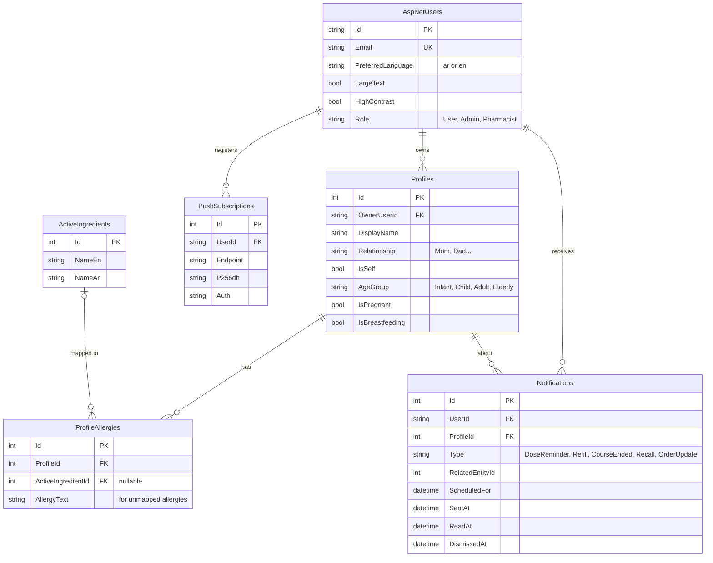
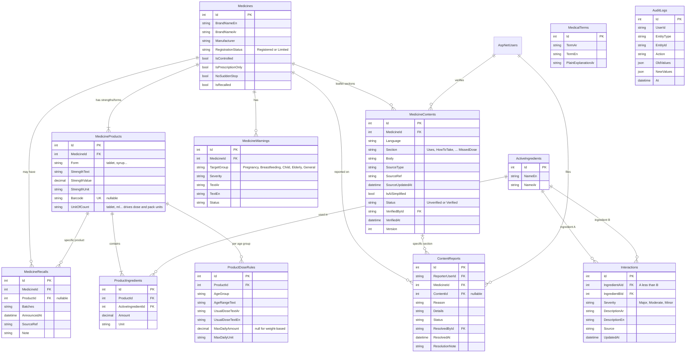
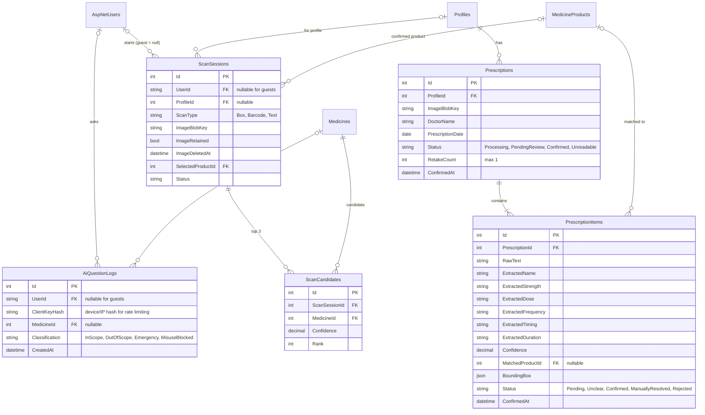
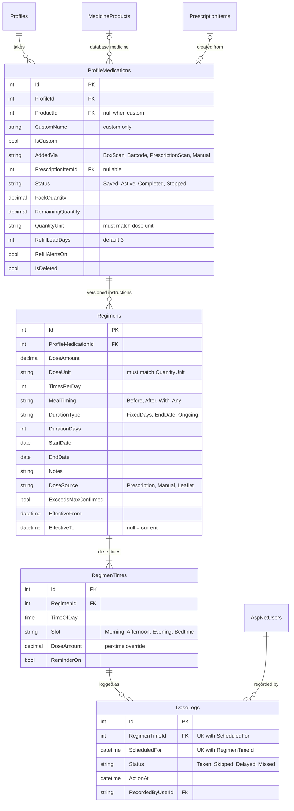
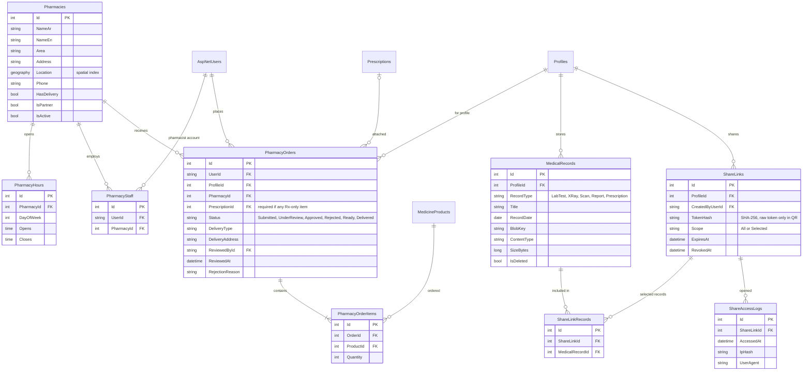

# Dawaya: ER diagrams

Five focused diagrams covering the whole schema. All tables also carry `CreatedAt` / `UpdatedAt` (omitted here for readability). Legend: `PK` primary key, `FK` foreign key, `UK` unique.

**Decisions built in:**
1. `ProfileMedications.Status` is `Saved` (no regimen) or `Active` once a regimen exists.
2. Custom medicines get refill alerts, so the quantity fields live on `ProfileMedications`, not only on the product.
3. The max-daily-dose check is skipped for Child and Infant profiles.
4. `QuantityUnit` and `DoseUnit` must match, enforced through `MedicineProducts.UnitOfCount`.
5. A dose becomes `Missed` after a grace window: 2 hours, or halfway to the next dose if shorter (a system setting, not a column).
6. Guests may ask the AI, rate-limited per device/IP (`AiQuestionLogs.ClientKeyHash`).

---

## 1. Identity, profiles and allergies

---

## 2. Medicine catalog, interactions, content and admin

---

## 3. Scanning, AI questions and prescriptions

---

## 4. Profile medications, regimens, schedule and dose tracking

---

## 5. Pharmacies, orders, medical records and QR sharing

